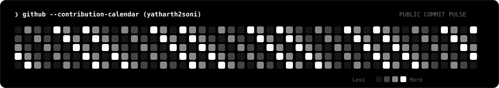
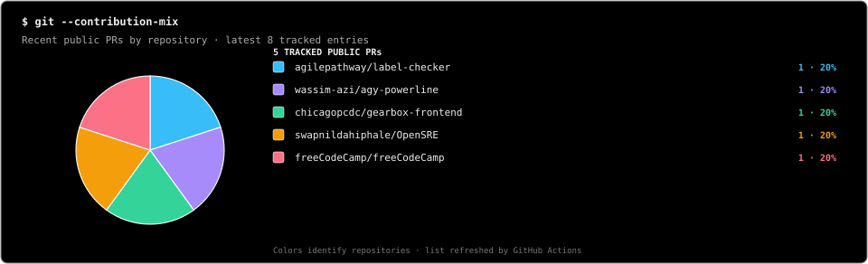
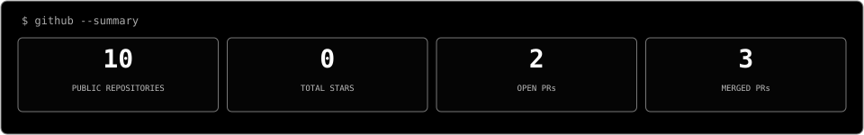
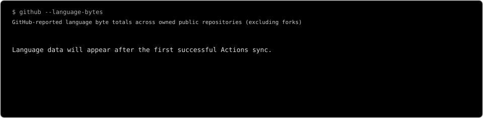

<div align="center">

<!-- Full-profile circular reveal: this GIF is a summary of the sections below. -->


[](https://github.com/yatharth2soni)
[](https://www.linkedin.com/in/yatharth-soni-85b826378/)
[](https://github.com/yatharth2soni?tab=repositories)

</div>

---

### `❯ cat about.md`

I'm **Yatharth Soni**, a **BTech Computer Science student at LNMIIT** interested in practical software projects, problem-solving, and open-source development. I enjoy exploring unfamiliar codebases and improving them through features, bug fixes, tests, and documentation.

- **Current focus:** Data Structures & Algorithms (DSA) and practising problems consistently.
- **Community:** Phoenix Club, LNMIIT.
- **Open source:** Learning from maintainers and contributing fixes, features, tests, themes, and documentation.
- **Approach:** Keep learning, write maintainable code, and turn feedback into improvements.

---

### `❯ ls ./toolkit`

| AREA | TOOLS |
|:--|:--|
| Languages | C · C++ · Java · Python · JavaScript · TypeScript · SQL |
| Frontend | React · Vite · Tailwind CSS |
| Backend & data | Node.js · NestJS · PostgreSQL · PostGIS · Prisma · MySQL |
| Developer tools | Git · GitHub · VS Code |

---

### `❯ ls ./projects`

<table>
<tr>
<td width="50%" valign="top">

**01 / Khanan Suraksha**

A bilingual mining-safety and governance platform for reporting, inspections, compliance workflows, and geo-tagged field observations.

`React` `NestJS` `PostgreSQL` `PostGIS`

[View repository →](https://github.com/yatharth2soni/final_sih)

</td>
<td width="50%" valign="top">

**02 / CF Ally**

A programming analytics dashboard focused on contest trends, performance insights, topic coverage, and problem-solving consistency.

`React` `TypeScript` `Chart.js`

[Browse project repositories →](https://github.com/yatharth2soni?tab=repositories)

</td>
</tr>
</table>

---

### `❯ git log --oneline ./contributions`

I contribute to real codebases through focused fixes, tests, themes, and documentation. The repository and pull-request tables below refresh automatically from GitHub's public API.

<!-- AUTO_PROFILE_START -->

<div align="center">

**PUBLIC REPOSITORIES: 10**　 **STARS: 0**　 **OPEN PRs: 2**　 **MERGED PRs: 3**

</div>

#### `./repositories` — recently pushed public repositories

| REPOSITORY | DESCRIPTION | LANGUAGE | ⭐ | LAST PUSH |
|:--|:--|:--|--:|:--|
| [label-checker](https://github.com/yatharth2soni/label-checker) | Label-checking tool; contributed Copilot session-start guidance | — | 0 | 2026-10-19 |
| [agy-powerline](https://github.com/yatharth2soni/agy-powerline) | Terminal statusline; contributed a Catppuccin Macchiato theme | — | 0 | 2026-10-18 |
| [gearbox-frontend](https://github.com/yatharth2soni/gearbox-frontend) | Frontend prototype; open documentation PR | — | 0 | 2026-10-17 |
| [OpenSRE](https://github.com/yatharth2soni/OpenSRE) | AI SRE tool; contributed remote-agent connection checks | — | 0 | 2026-10-17 |
| [freeCodeCamp](https://github.com/yatharth2soni/freeCodeCamp) | Open-source curriculum; contributed a quiz text correction | — | 0 | 2026-10-17 |
| [final_sih](https://github.com/yatharth2soni/final_sih) | Khanan Suraksha mining-safety project | JavaScript | 0 | 2026-09-01 |
| [sih4](https://github.com/yatharth2soni/sih4) | Hackathon project repository | Python | 0 | 2026-08-27 |
| [hackathon3](https://github.com/yatharth2soni/hackathon3) | Hackathon project repository | Python | 0 | 2026-08-26 |
| [codes_sih](https://github.com/yatharth2soni/codes_sih) | Hackathon project code | TypeScript | 0 | 2026-08-25 |
| [sih](https://github.com/yatharth2soni/sih) | Hackathon project repository | TypeScript | 0 | 2026-08-25 |

[View all public repositories →](https://github.com/yatharth2soni?tab=repositories)

#### `./pull-requests` — latest public pull-request activity

| REPOSITORY | PULL REQUEST | STATUS | UPDATED |
|:--|:--|:--:|:--|
| [freeCodeCamp](https://github.com/freeCodeCamp/freeCodeCamp) | [Fix curriculum quiz spacing #71054](https://github.com/freeCodeCamp/freeCodeCamp/pull/71054) | **MERGED** | 2026-10-17 |
| [agy-powerline](https://github.com/wassim-azi/agy-powerline) | [Add Catppuccin Macchiato theme #36](https://github.com/wassim-azi/agy-powerline/pull/36) | **MERGED** | 2026-10-18 |
| [label-checker](https://github.com/agilepathway/label-checker) | [Run npm ci at start of Copilot sessions #732](https://github.com/agilepathway/label-checker/pull/732) | **MERGED** | 2026-10-19 |
| [OpenSRE](https://github.com/swapnildahiphale/OpenSRE) | [Verify remote-agent connection status #88](https://github.com/swapnildahiphale/OpenSRE/pull/88) | **OPEN** | 2026-10-17 |
| [GEARBOx frontend](https://github.com/chicagopcdc/gearbox-frontend) | [Update frontend README #416](https://github.com/chicagopcdc/gearbox-frontend/pull/416) | **OPEN** | 2026-10-17 |

<sub>Starter data verified on 19 October 2026; the hourly workflow replaces it with current public results.</sub>

<!-- AUTO_PROFILE_END -->

---

### `❯ github --contribution-calendar`

<div align="center">



</div>

### `❯ git --contribution-mix`

<div align="center">







</div>

---

### `❯ cat focus.txt`

```text
[+] Practicing data structures & algorithms (DSA)
[+] Solving problems consistently and learning patterns
[+] Building full-stack projects
[+] Improving tests, documentation and maintainability
[+] Learning from reviews and contributing upstream
```

---

<div align="center">

### `❯ ./connect.sh`

[GitHub](https://github.com/yatharth2soni) · [LinkedIn](https://www.linkedin.com/in/yatharth-soni-85b826378/)


</div>
