



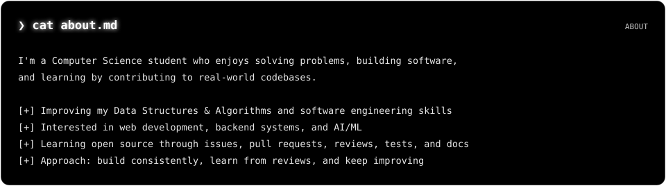


<a href="https://github.com/wassim-azi/agy-powerline/pull/36">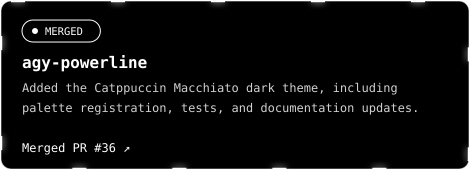</a>
<a href="https://github.com/agilepathway/label-checker/pull/732">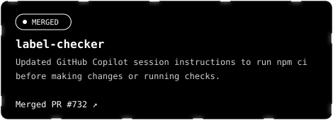</a>
<a href="https://github.com/freeCodeCamp/freeCodeCamp/pull/71054">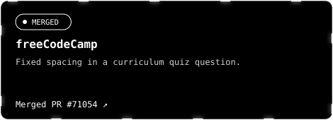</a>
<a href="https://github.com/swapnildahiphale/OpenSRE/pull/88">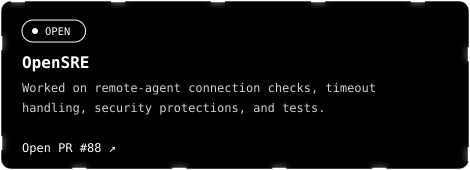</a>

<a href="https://github.com/yatharth2soni/final_sih">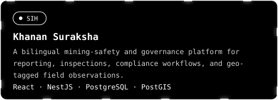</a>
<a href="https://github.com/yatharth2soni/CF_ally">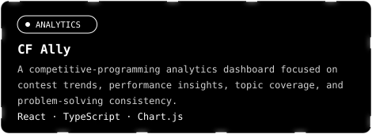</a>

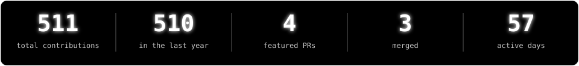
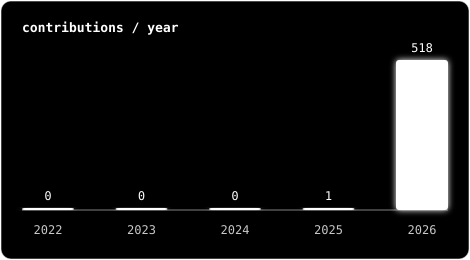
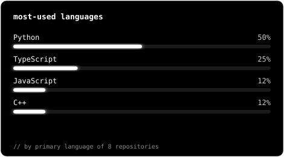

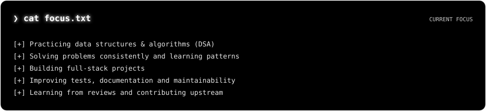

